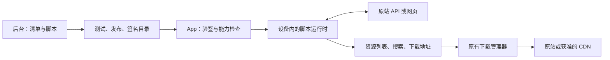

# 通用远程来源接入包

状态：第一阶段已实现，已完成代码、后台与原生组件验收；2026-10-17 随后按用户要求编译了 Android arm64 APK 和 Windows x64 安装包，并完成包体与运行库检查。尚未进行 Android 真机或完整应用交互验收。安装包含新运行时和下载组件的新版客户端后，可在已开放能力范围内通过后台新增、修复和停用来源。

## 数据流

后台管理清单与脚本、测试草稿、签名发布目录。App 下载并验证目录，在设备上运行来源脚本，直接访问原站；下载仍进入原有下载管理器。来源接入包这条通路的后台原站访问只发生在管理员主动执行来源测试时。

来源以稳定的 `sourceId` 标识，独立于现有 `CloudPlatform` 枚举。增加新网站不需要先为它添加网盘枚举值。旧版 v1–v4 解析规则与现有网盘账号连接器继续使用各自入口；来源候选与内置识别重叠时，用户可以选择通道。

## 当前能力

| 能力 | 第一阶段实现 |
| --- | --- |
| 新来源识别 | 下发域名、路径前缀和查询参数名匹配；支持多个来源候选 |
| 脚本 | 包内 ES modules、相对导入、BigInt、async/await；每次操作独立运行 |
| 网络 | 七种 HTTP 方法；JSON、表单、文本、Base64 二进制和小型 multipart 请求体；受控重定向 |
| 页面与运算 | HTML/CSS 选择器；UTF-8、GBK/GB2312、Latin1；编码、摘要、HMAC、AES-CBC、RSA 加密 |
| 浏览 | `resolve/list/search/detail`，目录、分页、搜索、文字详情、文件多选 |
| 下载 | `download` 返回候选地址及请求头，交给现有队列；失败后可按原包版本重新取链并轮换候选 |
| 后台 | 草稿、模块编辑、异步测试和取消、发布、启用/停用、历史回退、归档 |
| 分发 | RSA-SHA256 验签、包哈希、递增目录版本、兼容能力过滤、本地缓存 |
| 诊断 | 来源/脚本错误码；后台测试保留状态码、耗时、请求次数和读取字节数 |

返回模型目前以文件和目录为主。额外的操作名可以出现在清单中，但客户端通用界面只驱动上述五种操作。HTTP 的 multipart 能力用于有界请求体，尚不构成从用户文件系统选择文件并上传的完整功能。

## 运行时与能力协议

使用官方 QuickJS-NG v0.14.0 源码，通过项目内 `asterlink_js` 插件的 C 桥接与 Dart FFI 调用。JavaScript 位于独立 isolate，内容提取和密码学计算也移出界面 isolate。后台测试 CLI 复用同一套 Dart 宿主、返回模型和脚本引擎。

脚本只能调用 `api.request/html/crypto/codec/sleep`。没有文件系统、进程、App 账号存储或浏览器句柄接口。HTTP 响应本身不执行网页脚本；需要真实页面环境的网站留待浏览器能力阶段。

清单使用 `requires` 声明所需能力。目前 `source/javascript/http/html/crypto/codec` 均为版本 1。App 拉取目录时附带能力信息；后台仍返回统一的完整签名目录，客户端校验后过滤不兼容的包。当前未实现按设备生成不同目录或灰度分流。

主要预算：

- 单包最大 256 KiB，最多 16 个包内模块；模块不能从外部仓库或网络加载。
- 每次操作的 JS 堆上限 32 MiB、栈上限 512 KiB。32 MiB 是 JS 堆限制，不是整个进程的内存上限。
- 每次进入引擎最多 250 ms，累计执行预算 5 秒；操作总时限默认 120 秒，可声明为 1–300 秒。
- 单操作最多 120 次 `api.request`；请求体 1 MiB、HTTP 响应 512 KiB；宿主消息和脚本返回另有 1 MiB 限制。
- 取消会关闭关联连接，并终止运算 isolate 或释放 VM。循环超时由原生引擎中断处理。

详细接口与实际示例见 [来源 SDK](REMOTE-SOURCE-SDK.md)。

## 权限覆盖到下载连接

清单分别声明 API 域名 `hosts` 和下载域名 `downloadHosts`，同时限定协议、端口、方法和脚本请求头。域名支持显式子域通配；`*.example.com` 不包含根域 `example.com`。

API 请求、下载探测及 Go 下载组件均验证目标。重定向逐跳检查，禁止 HTTPS 降级至 HTTP。跨 origin 跳转会移除 Cookie、Authorization、自定义令牌和 Referer；之后跳回原域也不会恢复已移除的值。下载组件不缓存来源任务的跳转终点，避免后续分片重新附带原始凭据。

连接前检查 DNS 的全部结果，并固定连接到通过检查的公网 IP；TLS 保留原域名校验。网络权限随任务持久化并传入原生组件。缺失权限的来源任务、缺少 `sourceNetworkPolicy` 能力的旧下载组件会被拒绝，避免旧组件忽略约束。

接入包内容对客户端可读，长期密钥、账号密码等不能通过写入模块源码保密。现阶段没有每来源的持久 Cookie jar 或账号凭据库。

## 分发、版本与恢复

新增客户端接口 `/v1/sources` 使用现有后台连接配置与签名公钥。目录内包含各来源的 ID、发布版本、哈希和完整包；目录整体签名，并带用途标识、签发时间、有效期和递增 `revision`。

目录有效期为 7 天；App 启动时拉取，此后每 15 分钟刷新。拉取失败时可继续使用尚在有效期内的已验签目录。缓存即使过期，仍保留用于防止旧目录覆盖新目录的版本记录。

后台最多保留 128 个未归档来源，最多同时启用 64 个；发布目录也有总体大小限制。草稿变更会使旧测试结果失效，发布当前草稿需要其在 24 小时内通过列表、取链和下载读取测试。回退复用历史包内容并发布为更高版本，目录版本继续递增。

下载任务保存来源 ID、包版本、包哈希、签名目录证明和恢复上下文。恢复或重新取链使用原包，不自动切换到新版本。历史目录缓存最多 64 份、合计 64 MiB，保留任务引用及最近一小时使用的记录；空间不足时给出明确错误。

客户端收到停用或归档目录后，拒绝该来源的后续脚本执行和重新取链。此机制依赖目录刷新；已经进入下载引擎的传输不会因后台停用而立即被远程中断。返回的 `expiresAt` 目前只校验格式，未接入到期前主动刷新。

## 后续扩展路线

| 阶段 | 需要补充的客户端能力 | 后台可随之下发的变化 |
| --- | --- | --- |
| 登录与交互 | 每来源/账号会话、表单、二维码、浏览器登录、验证码完成后恢复、Token 刷新 | 登录入口、成功条件、会话刷新和多阶段取链 |
| 账号与文件操作 | 动态账号模型、配额、文件选择、上传、转存、移动/删除；写操作调度与幂等处理 | 新账号连接器及文件操作协议 |
| 新传输类型 | 按来源需求加入 HLS/DASH、WebSocket、持续 SSE 或其他原生协议 | 已实现协议内的地址、参数和鉴权逻辑 |
| 管理与诊断 | 公共模块仓库及版本锁定、测试样本/回放、客户端诊断、分批发布 | 模块复用、兼容性测试和更精细的发布控制 |

第一阶段的来源下载明确拒绝 HLS。网页登录、账号登录、上传、媒体协议和公共模块仓库尚未实现，不能仅靠新增清单字段启用。新增系统权限、原生协议、浏览器内核或下载内核修复仍需要客户端升级。

## 代码与交付材料

- 客户端：`lib/data/sources/`、`lib/ui/source_browser_page.dart`、`lib/domain/download_network_policy.dart`，以及 AppServices、解析页、下载管理器和原生引擎接入点。
- 脚本组件：`vendor_plugins/asterlink_js/`；官方源码摘要和第三方许可随仓库保留。
- 后台站点、测试 CLI、部署说明和本机验收记录在本地单独维护，不随客户端仓库发布；发布范围见 [上传与发布](GITHUB-PUBLISH.md)。
